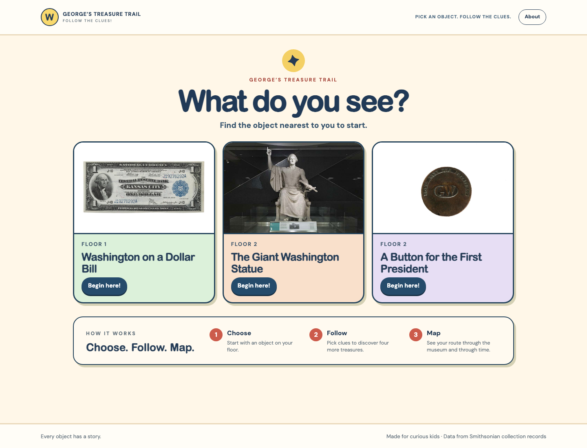
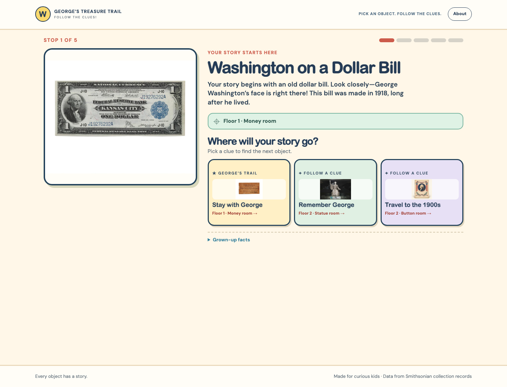
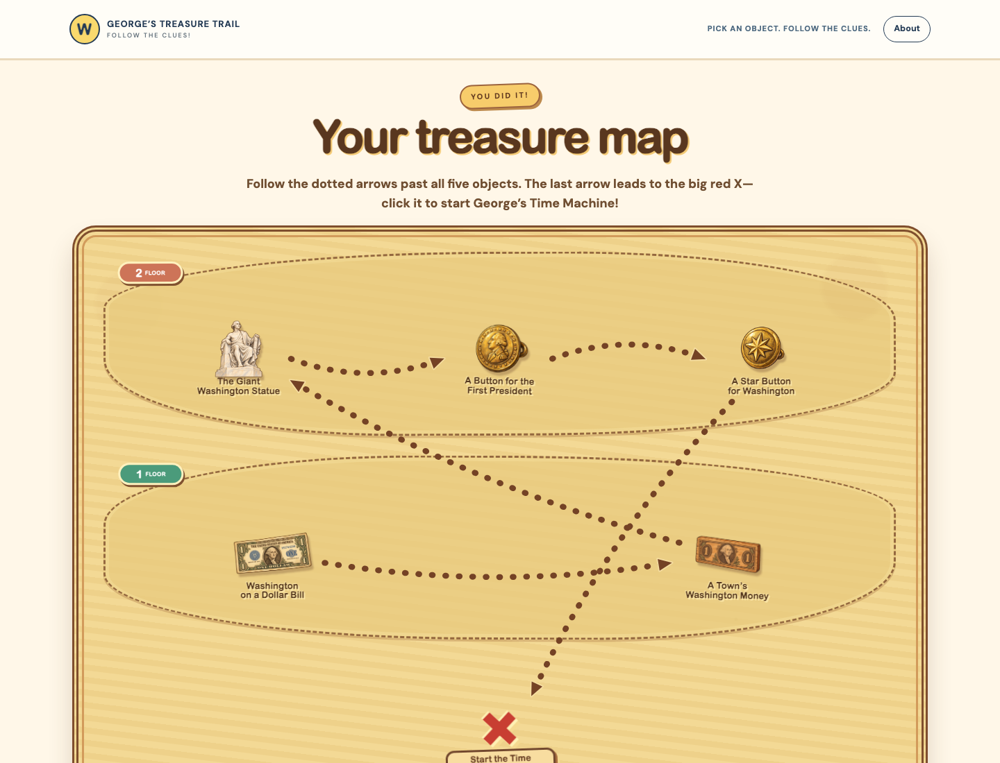

# George’s Treasure Trail

[View the live project](https://catietaras.github.io/major_studio_project_001_part_2/) · [View the repository](https://github.com/catietaras/major_studio_project_001_part_2)

George’s Treasure Trail is an interactive, kid-friendly exploration of George Washington objects at the Smithsonian’s National Museum of American History. Visitors begin with a nearby object, follow connections based on materials, topics, and time periods, and finish with a personalized five-stop treasure map and time-machine comparison.

## Progress update

The overall project structure and primary visitor journey are now complete. This update:

- finalized the landing page and explains the choose–follow–map interaction;
- connects three starting objects to a reviewed collection dataset;
- includes five-stop branching object stories, museum locations, and grown-up facts;
- completes the personalized treasure-map and time-machine ending;
- adds responsive layouts, keyboard navigation, project context, and data limitations;
- verifies local data and image paths and prepares the static site for GitHub Pages.

## Project screenshots

### Choose a starting object



### Follow a clue



### See your treasure map



## Data and sources

The project uses curated and expanded JSON datasets in `data/`. Object metadata and source links are based on Smithsonian collection records. Interpretive illustrations are labeled in the interface, and museum locations may change over time.

## Run locally

The project is a static HTML, CSS, and JavaScript site. Because it loads JSON with `fetch`, serve the repository through a local web server instead of opening `index.html` directly:

```bash
python3 -m http.server 8000
```

Then open `http://localhost:8000`.

## Deployment

GitHub Pages serves the site from the repository’s `main` branch at the public URL linked above. The `.nojekyll` file keeps the static project structure unchanged during publishing.
